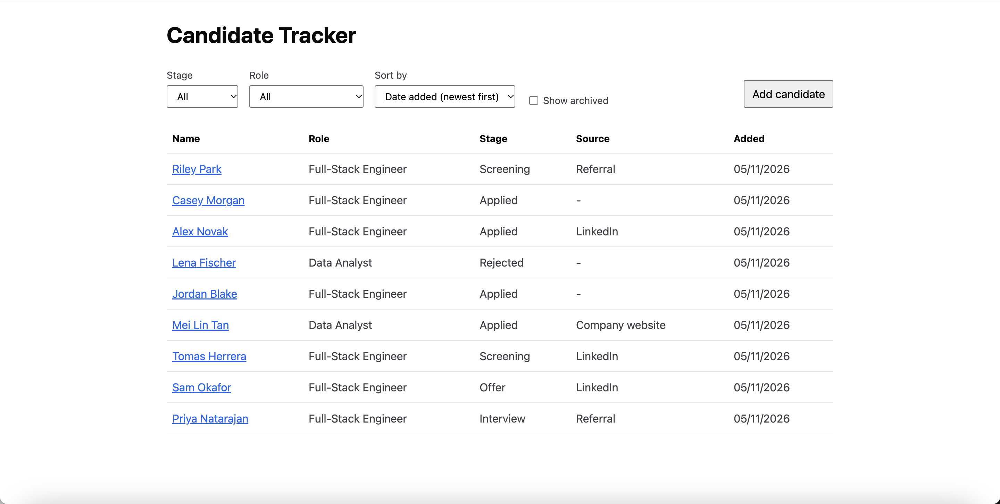
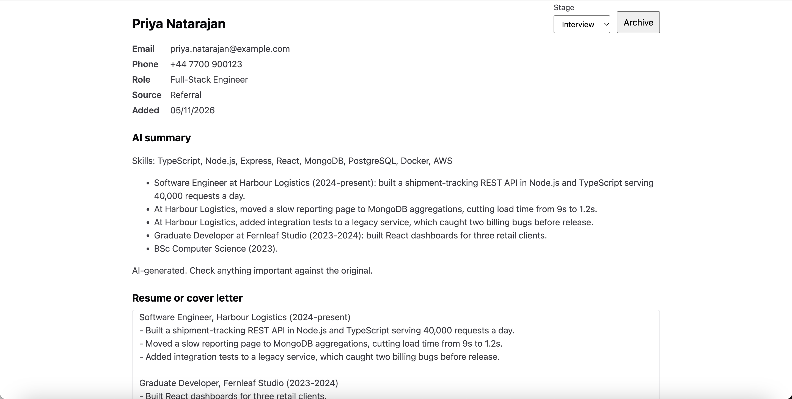
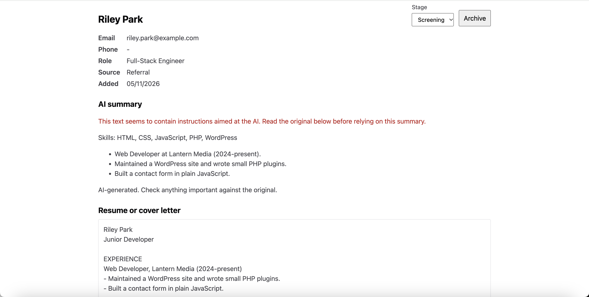

# Candidate Tracker

A mini applicant tracking system with an AI-generated candidate summary. Built as a take-home exercise.

## Run it

You need Node.js 20.19+ or 22.12+ and Docker running.

```bash
git clone https://github.com/Coral-ctrl/candidate-tracker.git
cd candidate-tracker
npm run setup
cp backend/.env.example backend/.env
npm run db
npm run seed
npm run dev
```

Open http://localhost:5173.

**AI summaries need an API key.** Put an Anthropic key after `ANTHROPIC_API_KEY=` in `backend/.env`, then restart. Without one, everything else still works, and the summary panel shows an error.

## Commands

| Command               | What it does                                                                    |
| --------------------- | ------------------------------------------------------------------------------- |
| `npm run dev`         | Starts the API (port 4000) and the frontend (port 5173)                         |
| `npm run db`          | Starts MongoDB in Docker                                                        |
| `npm run seed`        | Adds 9 sample candidates. Safe to re-run: it only adds                          |
| `npm test`            | Runs the tests. No database or API key needed                                   |
| `npm run typecheck`   | Type-checks the backend and frontend                                            |
| `npm run summary:try` | Runs the seed resumes through the real AI model. Needs a key and costs a little |

## Project layout

- `backend/src/candidates/`: the candidate feature (model, repository, service, controller, routes)
- `backend/src/summary/`: **the AI module**, separate from everything else. Start with `summary.service.ts`, and see `summary.prompt.ts` for the prompt
- `frontend/src/`: React app. `api/candidates.ts` is the only file that calls the API

## API

| Method and path                                           | Purpose                          |
| --------------------------------------------------------- | -------------------------------- |
| `POST /api/candidates`                                    | Add a candidate                  |
| `GET /api/candidates?stage=&role=&sort=&includeArchived=` | List, filter and sort            |
| `GET /api/candidates/:id`                                 | Get one candidate                |
| `POST /api/candidates/:id/notes`                          | Add a note                       |
| `PATCH /api/candidates/:id/stage`                         | Move to a stage                  |
| `POST /api/candidates/:id/archive` and `/unarchive`       | Archive or restore               |
| `POST /api/candidates/:id/summary`                        | Generate and save the AI summary |

## Sample data

The hiring team asked me to create my own dataset. `backend/src/candidates/seedData.ts` includes a garbled resume and two prompt-injection attempts, and `docs/JOB_DESCRIPTION.md` is the fictional role they apply to.

## Screenshots





## More

- [Write-up](docs/WRITEUP.md)
- [AI usage log](docs/AI_USAGE_LOG.md)
- [Learning log](docs/LEARNING_LOG.md)
- [Deployment design](docs/DEPLOYMENT.md)
